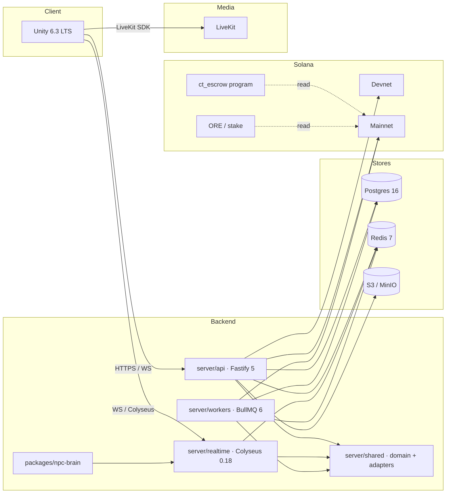

# CT Life — backend

CT Life is a 3D multiplayer Crypto Twitter life-sim on Solana, built native for the Solana Seeker phone. This repository contains everything server-side: REST API, realtime rooms, background workers, the on-chain `ct_escrow` program, the cross-team contract, headless test bots, and deployment config. The Unity client lives in a separate repo and pulls `contract/` from here.

## Status

| Milestone | Description                       | Status      |
| --------- | --------------------------------- | ----------- |
| M0        | Foundation and verification       | in progress |
| M1        | The contract (versioned, codegen) | not started |
| M2        | Phase 1: City and identity        | not started |
| M3        | Phase 2: Money and markets        | not started |
| M4        | Phase 3: Voice and calls          | not started |
| M5        | Phase 4: City life                | not started |
| M6        | Phase 5: Projects and ads         | not started |
| M7        | Phase 6: Competition              | not started |
| M8        | Hardening, deployment, handover   | not started |

See `docs/PROGRESS.md` for live status and `docs/TEST_REPORT.md` for per-milestone proof.

## Architecture



## Quick start

```bash
# 1. Toolchain
nvm use                    # Node 22
corepack enable            # pnpm

# 2. Environment
cp .env.example .env
# Fill in the credentials listed in .env.example. Required ones
# (Helius, LiveKit, treasury pubkeys, keypairs) are documented inline.

# 3. Local stack (Postgres, Redis, LiveKit dev, MinIO, api, realtime, workers)
pnpm dev:up

# 4. Smoke test every external dependency
pnpm smoke

# 5. Lint and typecheck
pnpm lint
pnpm typecheck

# 6. Run the contract checks (M1 onwards)
pnpm contract:check
```

## Environments

| Env       | REST             | Realtime         | Solana                      | Notes                                                     |
| --------- | ---------------- | ---------------- | --------------------------- | --------------------------------------------------------- |
| `local`   | `localhost:4010` | `localhost:2567` | devnet                      | Real stack via Docker Compose                             |
| `mock`    | `localhost:4010` | `localhost:2567` | devnet                      | Same stack with `ENABLE_DEV_AUTH=true` and bot population |
| `staging` | Railway          | Railway          | devnet + mainnet (ORE, SGT) | Two real Seekers for the integration checklist            |
| `prod`    | Railway          | Railway          | mainnet                     | Public launch                                             |

## Repository layout

```
ct-life-backend/
├── contract/         # Source of truth (OpenAPI, Colyseus schemas, IDs, config, IDL)
├── server/
│   ├── api/          # Fastify 5 REST
│   ├── realtime/     # Colyseus 0.18 rooms
│   ├── workers/      # BullMQ jobs
│   └── shared/       # Domain + adapters (db, redis, ledger, auth, solana, livekit)
├── packages/
│   └── npc-brain/    # Pure, deterministic NPC state machines
├── programs/ct_escrow/  # Anchor 0.31 program
├── tools/
│   ├── bots/         # Headless real-keypair clients for e2e and load
│   ├── econ-sim/     # 1,000-player economy simulator
│   ├── contract-check/  # Schema, codegen, response validation
│   └── scripts/      # keygen, smoke, docs-check, boundary-check
├── db/migrations/    # node-pg-migrate SQL
├── docs/             # spec/, adr/, all top-level docs
└── .github/workflows/ci.yml
```

## Scripts

| Command                 | What it does                                                                        |
| ----------------------- | ----------------------------------------------------------------------------------- |
| `pnpm dev:up`           | Start the local stack (Postgres, Redis, LiveKit dev, MinIO, api, realtime, workers) |
| `pnpm dev:down`         | Stop the local stack                                                                |
| `pnpm dev:logs`         | Tail the stack logs                                                                 |
| `pnpm smoke`            | Smoke-test every external dependency                                                |
| `pnpm keygen`           | Generate a devnet keypair (treasury, settle authority, admin)                       |
| `pnpm typecheck`        | TypeScript `strict` over all workspaces                                             |
| `pnpm lint`             | ESLint (incl. JSDoc, layering) over all workspaces                                  |
| `pnpm format`           | Prettier write                                                                      |
| `pnpm test`             | All test suites                                                                     |
| `pnpm test:unit`        | Pure unit tests                                                                     |
| `pnpm test:integration` | Real Postgres + Redis via Compose                                                   |
| `pnpm test:e2e`         | Bots on real devnet (gated by `ENABLE_E2E=1`)                                       |
| `pnpm contract:check`   | Schema, codegen, response validation                                                |
| `pnpm contract:codegen` | Run codegen into `contract/openapi/generated/` and `contract/realtime/generated/`   |
| `pnpm docs:check`       | Verify env vars, error codes, room messages are documented                          |
| `pnpm boundary:check`   | Verify layering (domain never imports transport)                                    |
| `pnpm anchor:build`     | Build the `ct_escrow` program                                                       |
| `pnpm anchor:test`      | Run Anchor tests on `solana-test-validator`                                         |

## Environment variables

The full list with purpose, required/optional, and example lives in `.env.example`. The `docs:check` script fails the build if any variable referenced in code is missing from either place.

| Group            | Examples                                                                                                                |
| ---------------- | ----------------------------------------------------------------------------------------------------------------------- |
| Solana           | `SOLANA_RPC_URL_DEVNET`, `SOLANA_RPC_URL_MAINNET`, `TREASURY_PUBKEY_*`, `SETTLE_AUTHORITY_KEYPAIR_*`, `ADMIN_KEYPAIR_*` |
| Helius           | `HELIUS_API_KEY`, `HELIUS_WEBHOOK_SECRET`, `HELIUS_RPC_URL_*`                                                           |
| LiveKit          | `LIVEKIT_URL`, `LIVEKIT_API_KEY`, `LIVEKIT_API_SECRET`, `LIVEKIT_WEBHOOK_SECRET`                                        |
| Database / cache | `DATABASE_URL`, `REDIS_URL`                                                                                             |
| Auth             | `JWT_PRIVATE_KEY`, `JWT_KEY_ID`, `JWT_PUBLIC_KEY` (served via JWKS)                                                     |
| Storage          | `S3_ENDPOINT`, `S3_ACCESS_KEY`, `S3_SECRET_KEY`, `S3_BUCKET`                                                            |
| Auth flags       | `ENABLE_DEV_AUTH`, `APP_ENV`, `NODE_ENV`                                                                                |
| Optional M7+     | `ANTHROPIC_API_KEY`, `LLM_MODEL`, `X_CLIENT_ID`, `X_CLIENT_SECRET`                                                      |
| Optional M8      | `SENTRY_DSN`, `RAILWAY_TOKEN`                                                                                           |
| Bot safe-mode    | `RUN_MAINNET_TESTS`, `ENABLE_E2E`                                                                                       |

## Documentation

- `docs/PROGRESS.md` — milestone status, last commands, blockers
- `docs/DECISIONS.md` — quick log of decisions and deviations
- `docs/UNVERIFIED.md` — claims that cannot be checked in this environment
- `docs/TEST_REPORT.md` — milestone gate evidence (commands + output)
- `docs/HANDOVER.md` — what the teammate and ops need at hand-off
- `docs/ARCHITECTURE.md` — system overview, data flow diagrams, composition roots
- `docs/DATA_MODEL.md` — every table, column, index, constraint
- `docs/ECONOMY.md` — every faucet/sink, formula, parameter
- `docs/REALTIME.md` — every room, message, validation
- `docs/NPCS.md` — every archetype state machine
- `docs/ONCHAIN.md` — every program, PDA, instruction, event
- `docs/SECURITY.md` — threat model, authz matrix
- `docs/OPERATIONS.md`, `docs/RUNBOOK.md` — deploy, incident playbooks
- `docs/TESTING.md` — how to run every test layer
- `docs/adr/NNNN-title.md` — architecture decision records
- `CONTRIBUTING.md` — coding standards, branch and commit conventions

## License

Internal project. No public license.
