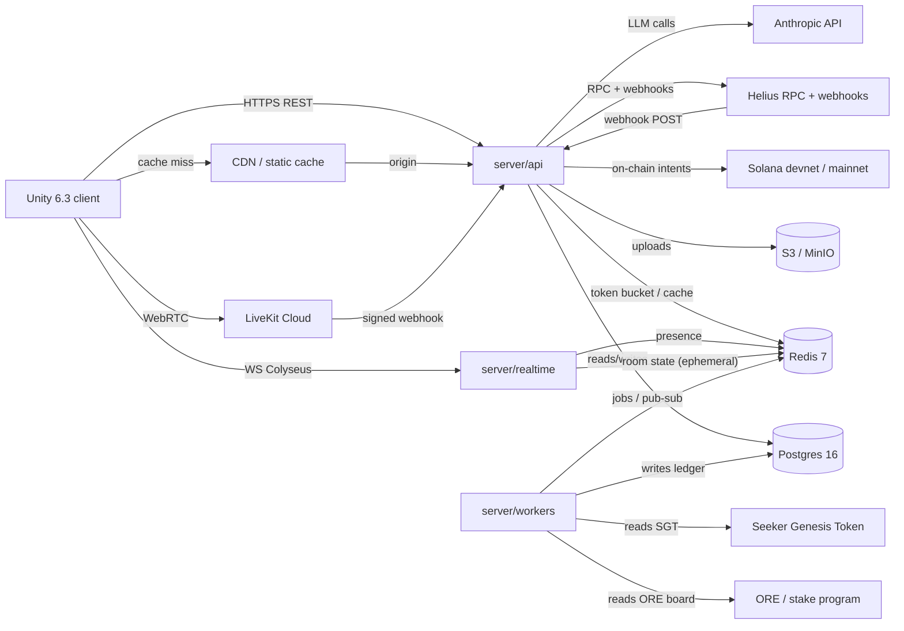
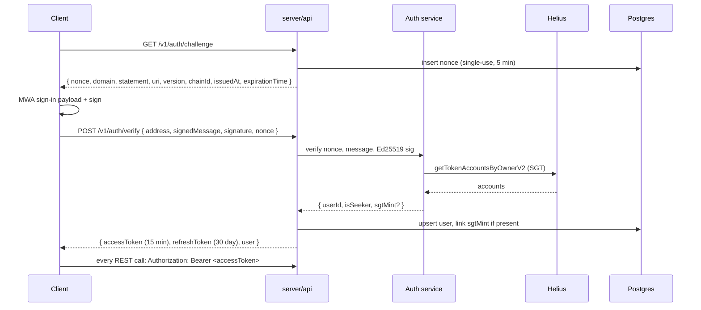
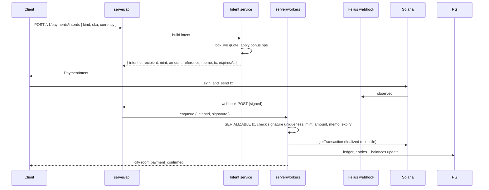
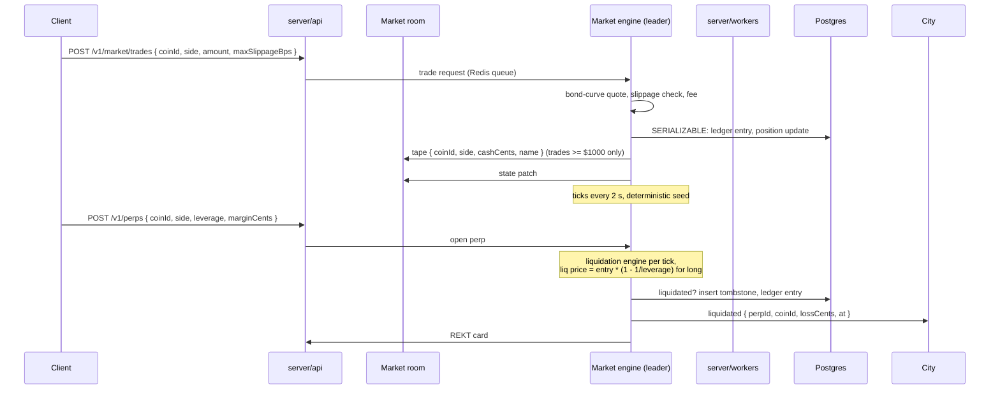
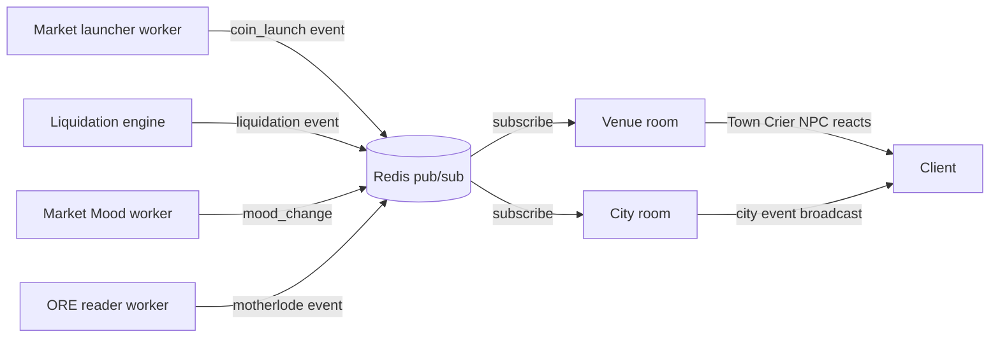
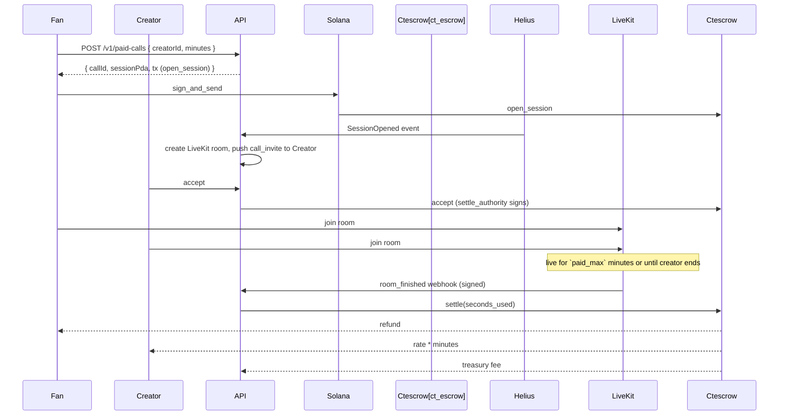
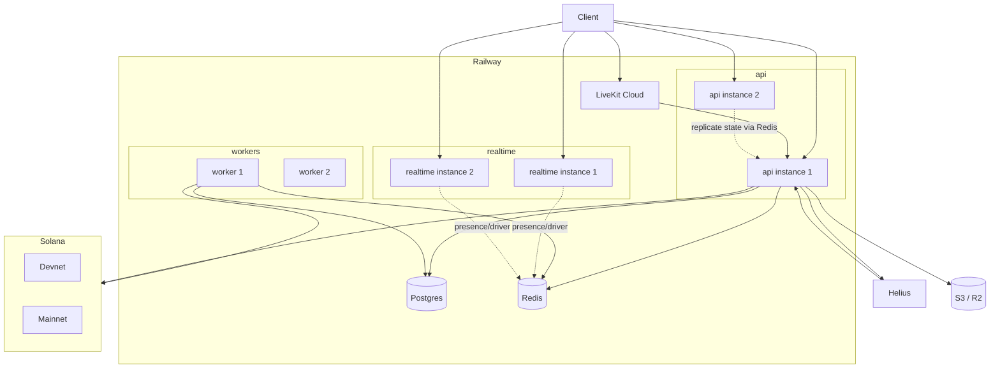

# Architecture

> System overview, process boundaries, data-flow diagrams, layering rules, and composition roots. Living document. The contract is in `contract/`, the source-of-truth for both teams.

## Process boundaries

The backend runs as four independently deployable processes. All shared state lives in Postgres or Redis. No in-process caches affect correctness; the only in-memory authoritative state is Colyseus room state, which is disposable or reconstructable.

| Process              | Language                   | Port | Replicas (prod)  | Replicas (local)    | Owns                                                                           |
| -------------------- | -------------------------- | ---- | ---------------- | ------------------- | ------------------------------------------------------------------------------ |
| `server/api`         | TypeScript / Fastify 5     | 4010 | 2+               | 1 (mock profile: 1) | REST                                                                           |
| `server/realtime`    | TypeScript / Colyseus 0.18 | 2567 | 2+ (M3+ sharded) | 1 (M0-M2)           | Realtime rooms                                                                 |
| `server/workers`     | TypeScript / BullMQ 6      | —    | 2+               | 1                   | Market tick, NPC events, Sunday Unlock, ORE reader, webhook ingest, daily clue |
| `programs/ct_escrow` | Rust / Anchor 0.31         | —    | n/a              | n/a                 | Paid-call escrow on Solana                                                     |

Each process has exactly one composition root (`main.ts`) that wires infrastructure adapters into the domain layer.

## Data flow



## Layering

Dependencies point inward only.

```
transport (Fastify routes, Colyseus rooms, BullMQ processors, webhooks)
  -> application services (use cases, orchestration, transactions)
    -> domain (entities, value objects, pure rules: ledger, perps, market curve, tax, NPC brain)
      <- infrastructure adapters (Postgres repos, Redis, Helius, LiveKit, Solana, S3, price feeds, LLM)
```

Rules:

- The domain layer (`server/shared/domain/**`, `packages/npc-brain/**`) imports nothing from transport or infrastructure. Enforced by `tools/scripts/boundary-check.ts` and an ESLint `no-restricted-imports` rule in `eslint.config.mjs`.
- Composition roots (`server/api/main.ts`, `server/realtime/main.ts`, `server/workers/main.ts`) are the only places that wire infrastructure to the domain. They are the only places allowed to import transport.
- Money is a value object (`Cents`, `TokenAmount` with `bigint` base units). No `number` for money in domain code, no floating-point money math. `decimal.js` is allowed at the price-feed boundary only.
- Errors are a typed domain hierarchy. They are mapped to contract error codes in exactly one place, the transport boundary. No `throw new Error("…")` in business logic.
- One `Unit of Work` per ledger transaction. Services cannot forget to commit or roll back; the UoW is the only thing that calls `BEGIN` / `COMMIT` / `ROLLBACK`.
- Soft limits: functions about 40 lines, files about 300 lines, justified exceptions in a header comment.

## Auth flow



The refresh token rotates and revokes. The JWT is RS256; the public key is at `/v1/auth/jwks`; rotation is supported via `kid`.

## Top-up payment flow



## Trade and liquidation flow (M3)



## Sunday Unlock flow (M5)

```mermaid
sequenceDiagram
  participant WK as Sunday Unlock worker
  participant PG as Postgres
  participant RD as Redis (flags)
  C->>WK: cron Sun 20:00 UTC
  WK->>PG: rent due (each player)
  WK->>PG: gas bill (each player)
  WK->>PG: debt repayment (each player with debt) + 10% penalty if missed
  WK->>PG: Weekly Meta rotation
  C->>WK: cron Mon 00:00 UTC
  WK->>PG: tax reset, weekly boards reset
  Note over WK: idempotent; safe if run twice or missed (catch-up on boot)
```

## NPC event propagation (M2+)



## Paid-call flow (M4)



## Deployment topology



## See also

- `docs/DATA_MODEL.md` — tables, columns, indexes, ledger invariants
- `docs/REALTIME.md` — every room, state field, message
- `docs/ONCHAIN.md` — every program, PDA, instruction
- `docs/SECURITY.md` — threat model and authz matrix
- `docs/OPERATIONS.md` — deploy, rollback, migrations
- `docs/adr/` — architecture decision records
