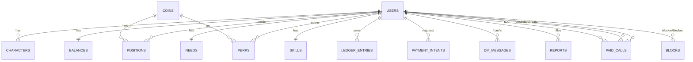

# Data model

> Every table, column, index, and constraint, with a plain-language description, an ER diagram, and the ledger invariants spelled out.

This file will be filled in as migrations land (M2+). M0 ships the migration framework and the first migration for `users`. The full schema is described here as a target; M2 starts implementing it.

## Tables (target)

### `users`

- `id uuid PRIMARY KEY` — UUIDv7, server-generated.
- `wallet text UNIQUE NOT NULL` — base58 Solana public key.
- `is_seeker boolean NOT NULL DEFAULT false` — Seeker Genesis Token verified.
- `sgt_mint text` — the specific Seeker Genesis Token mint that was verified, so one phone cannot verify two accounts.
- `skr_name text` — `.skr` name if linked.
- `created_at timestamptz NOT NULL DEFAULT now()`.

### `characters`

- `id uuid PRIMARY KEY`
- `user_id uuid NOT NULL REFERENCES users(id) ON DELETE CASCADE`
- `alias text UNIQUE NOT NULL`
- `look jsonb NOT NULL` — `{ skinTone, headId, hairId, topId, bottomId, shoesId, accId }`
- `tribe_id text NOT NULL`
- `trait_ids text[] NOT NULL`
- `dream_id text NOT NULL`
- `age_confirmed_at timestamptz`
- `home_id text NOT NULL`
- `tribe_changed_at timestamptz` — one tribe change per season
- `created_at timestamptz NOT NULL DEFAULT now()`

### `balances` (M2)

- `user_id uuid PRIMARY KEY REFERENCES users(id) ON DELETE CASCADE`
- `cash_cents bigint NOT NULL DEFAULT 0` — Cash in cents. Cached; reconciled from `ledger_entries`.
- `debt_cents bigint NOT NULL DEFAULT 0` — Cash owed, in cents.

### `ledger_entries` (M2, append-only)

- `id bigserial PRIMARY KEY`
- `user_id uuid NOT NULL REFERENCES users(id) ON DELETE RESTRICT`
- `delta_cents bigint NOT NULL`
- `account text NOT NULL` — `cash` | `debt` | future accounts
- `reason text NOT NULL` — `topup`, `shift_pay`, `rent`, `tax`, `tip`, `trade_buy`, `trade_sell`, etc.
- `ref_type text` — `intent`, `trade`, `shift`, `tip`, `tombstone`, etc.
- `ref_id text` — the entity ID
- `idempotency_ref text UNIQUE` — for replay protection on payments, dedup
- `created_at timestamptz NOT NULL DEFAULT now()`

Append-only is enforced by a trigger that raises an exception on `UPDATE` or `DELETE`. The table is range-partitioned monthly by `created_at` to keep individual partitions small. Indexes:

- `(user_id, created_at DESC)` — per-user history
- `(ref_type, ref_id)` — find a ledger entry for an entity
- `(idempotency_ref)` — replay protection

### `needs` (M2, computed)

- `user_id uuid PRIMARY KEY REFERENCES users(id) ON DELETE CASCADE`
- `energy smallint NOT NULL DEFAULT 50`
- `hunger smallint NOT NULL DEFAULT 50`
- `fun smallint NOT NULL DEFAULT 50`
- `hygiene smallint NOT NULL DEFAULT 50`
- `sanity smallint NOT NULL DEFAULT 50`

Decay is computed on read from `last_action_at` against `needs.json`. The row stores the last write. Reads are cheap because decay is a small arithmetic on integers, no joins.

### `skills` (M2)

- `user_id uuid PRIMARY KEY REFERENCES users(id) ON DELETE CASCADE`
- `clout smallint NOT NULL DEFAULT 1` — 1 to 10
- `coding smallint NOT NULL DEFAULT 1`
- `trading smallint NOT NULL DEFAULT 1` — drives the leverage cap
- `writing smallint NOT NULL DEFAULT 1`
- `design smallint NOT NULL DEFAULT 1`
- `security smallint NOT NULL DEFAULT 1`

### `career_progress`

- `user_id uuid NOT NULL REFERENCES users(id) ON DELETE CASCADE`
- `career_id text NOT NULL` - a `careers.json` id
- `level smallint NOT NULL DEFAULT 1` - 1 to 5
- `xp integer NOT NULL DEFAULT 0` - progress inside the current level
- `applied_at timestamptz`, `updated_at timestamptz`
- `PRIMARY KEY (user_id, career_id)`

Written by apply (creates the row, never resets it) and by shift completion, in the same transaction as the pay. When `xp` reaches the level's `careers.json` `levels[].xp` threshold the player is promoted and the threshold is subtracted. `GET /v1/careers` and the next shift's pay read it.

### `payment_intents` (M3)

- `intent_id uuid PRIMARY KEY`
- `user_id uuid NOT NULL REFERENCES users(id)`
- `kind text NOT NULL` — `topup` | `cosmetic` | `ad` | `season_pass`
- `currency text NOT NULL` — `USDC` | `SOL` | `SKR` | `ORE`
- `amount text NOT NULL` — base units as a string
- `recipient text NOT NULL` — treasury pubkey
- `mint text` — null for SOL
- `reference text UNIQUE NOT NULL`
- `memo text NOT NULL` — the intent ID
- `cash_cents bigint` — for top-ups
- `bonus_bps smallint`
- `status text NOT NULL` — `pending` | `confirmed` | `expired` | `failed`
- `signature text` — set when confirmed
- `expires_at timestamptz NOT NULL`
- `created_at timestamptz NOT NULL DEFAULT now()`

`signature` is `UNIQUE` once set. Idempotency on crediting: a unique index on `signature` plus the webhook/poller path uses `ON CONFLICT DO NOTHING` to prevent double-credit.

### `coins` (M3)

- `coin_id uuid PRIMARY KEY`
- `ticker text UNIQUE NOT NULL`
- `name text NOT NULL`
- `stage text NOT NULL` — `new` | `final` | `graduated` | `dead`
- `price_micros bigint NOT NULL` — millionths of a Cash dollar per whole coin
- `mcap_cents bigint NOT NULL`
- `vol_5m_cents bigint NOT NULL DEFAULT 0`
- `change_5m_bps integer NOT NULL DEFAULT 0`
- `holders integer NOT NULL DEFAULT 0`
- `launched_at timestamptz NOT NULL`
- `hidden_arc jsonb NOT NULL` — `stealth`, `hype`, `peak`, `outcome`; never sent to the client
- `seed bigint NOT NULL` — deterministic seed for replay

### `positions` (M3)

- `position_id uuid PRIMARY KEY`
- `user_id uuid NOT NULL REFERENCES users(id)`
- `coin_id uuid NOT NULL REFERENCES coins(coin_id)`
- `units bigint NOT NULL`
- `cost_basis_cents bigint NOT NULL`
- `realized_cents bigint NOT NULL DEFAULT 0`
- `created_at timestamptz NOT NULL DEFAULT now()`

### `perps` (M3)

- `perp_id uuid PRIMARY KEY`
- `user_id uuid NOT NULL REFERENCES users(id)`
- `coin_id uuid NOT NULL REFERENCES coins(coin_id)`
- `side text NOT NULL` — `long` | `short`
- `leverage smallint NOT NULL`
- `margin_cents bigint NOT NULL`
- `entry_micros bigint NOT NULL`
- `liq_micros bigint NOT NULL`
- `status text NOT NULL` — `open` | `closed` | `liquidated`
- `realized_cents bigint`
- `closed_at timestamptz`
- `created_at timestamptz NOT NULL DEFAULT now()`

### `paid_calls` (M4)

- `call_id uuid PRIMARY KEY`
- `fan_user_id uuid NOT NULL REFERENCES users(id)`
- `creator_user_id uuid NOT NULL REFERENCES users(id)`
- `session_pda text NOT NULL`
- `status text NOT NULL` — `awaiting_payment` | `ringing` | `live` | `settled` | `refunded`
- `rate_per_min_usdc text NOT NULL`
- `max_minutes smallint NOT NULL`
- `started_at timestamptz`
- `ended_at timestamptz`
- `minutes_used smallint`
- `creator_amount text`
- `fee text`
- `refund_amount text`
- `created_at timestamptz NOT NULL DEFAULT now()`

### `dm_messages` (M3)

- `message_id uuid PRIMARY KEY`
- `from_user_id uuid NOT NULL REFERENCES users(id)`
- `to_user_id uuid NOT NULL REFERENCES users(id)`
- `text text NOT NULL` — 500 char cap, validated
- `created_at timestamptz NOT NULL DEFAULT now()`

### `reports` and `blocks` (M1/M2)

- `report_id`, `reporter_user_id`, `target_type`, `target_id`, `reason_id`, `note`, `created_at`, `resolved_by`, `resolved_at`.
- `target_type` is `user | message | space | call | post | ad | npc_reply` (migration 106 added `npc_reply`: an AI NPC chat reply, `target_id` = `llm_npc_interactions.interaction_id`).
- `block_id`, `blocker_user_id`, `blocked_user_id`, `created_at`. `UNIQUE (blocker_user_id, blocked_user_id)`.

### `webhook_events` (M3)

- `event_id uuid PRIMARY KEY`
- `source text NOT NULL` — `helius` | `livekit` | `ore`
- `payload jsonb NOT NULL`
- `received_at timestamptz NOT NULL DEFAULT now()`
- `processed_at timestamptz`
- `signature text` — for dedup; UNIQUE per (source, signature)

### Homes (M4, doors in migration 082)

- `homes`: one row per lease. `kind`, `rent_cents_per_week`, `last_rent_paid_at`, plus `unit_id` (the door held, `home_units`), `status` (`active | overdue | evicted | moved_out`), `missed_weeks` and `ended_at`. Only an active or overdue home holds its unit: a partial unique index on `unit_id` keeps one live lease per door, and `unit_id` stays on ended rows as history.
- `home_units`: `unit_id` (`flat:<buildingInstanceId>:<doorIndex>`), `district`, `tier` (`basement | flat | penthouse`), `room_type`, `weekly_rent_cents`, `capacity`. Upserted from `contract/ids/home_units.json` (frontend-owned) when the API first needs it.
- `home_guests`: `(home_id, user_id)`, the people the owner lets through the door.
- `home_visits`: append-only visit log, unchanged.

Flow: `POST /homes` takes a free unit of the kind's tier (`409 NO_FREE_UNIT` when all are held; a tier with no units leases without a door). The rent worker (Monday 00:00 UTC) moves a home `active` to `overdue` on a missed week and to `evicted` after 4 in a row, freeing the unit. It charges each live home at most once per rent week: the week's ledger row has the key `home-rent-weekly:<homeId>:<monday>`, the cash debit when paid or a zero-delta `rent_missed` row when not; `POST /homes/{homeId}/move-out` frees it by choice. `GET /units/{unitId}/access` and `POST /homes/{ownerId}/visit` allow the owner and guests of a live home and nobody else.

## ER diagram

## Ledger invariants

These are the hard rules the ledger must always satisfy. Tests assert each one. A violation is a P0 incident.

1. **Append-only.** `ledger_entries` cannot be `UPDATE`-d or `DELETE`-d. Enforced by a `BEFORE UPDATE OR DELETE` trigger that raises an exception. The `id` is `bigserial` and never reused.
2. **Conservation.** `sum(delta_cents WHERE account='cash') == sum(balances.cash_cents)`. A nightly reconciliation job asserts this and alerts on any mismatch.
3. **No negative cash.** After every transaction, `balances.cash_cents >= 0`. A debit that would push it negative must fail with `INSUFFICIENT_CASH` and roll back.
4. **Idempotency.** Crediting a payment is idempotent on `(source, signature)`. The webhook handler and the polling reconciler both use `INSERT ... ON CONFLICT (signature) DO NOTHING`. A unique index on `(source, signature)` enforces it.
5. **Money unit.** `cash_cents` is `bigint` cents, never `number` floats. Token amounts are `text` base units (decimal-aware).
6. **Per-transaction integrity.** Every money-mutating service runs in a `SERIALIZABLE` transaction (or with explicit row locks) and retries on `40001` (serialization failure) with jittered backoff. The Unit of Work pattern is the only way to commit.
7. **No hot rows.** No global row is updated on every transaction. Global aggregates (treasury balance, total burned, total paid) are derived from append-only entries on a schedule and cached in Redis. Source of truth is the entries.
8. **No reliance on Redis for money.** Money is only in Postgres. Losing Redis loses no money; presence and rate limits are lost instead.
9. **Bounded growth.** `ledger_entries` is monthly-partitioned; old partitions are detached and archived per the retention policy. Hot indexes are `(user_id, created_at DESC)` and `(ref_type, ref_id)`.
10. **Statement timeout.** Every transaction sets `statement_timeout` and `lock_timeout`. No query holds a lock for more than a few seconds.

## Likeness preparation

Migration `1700000075000_likeness_jobs.sql` adds dedicated verified purchase entitlements, private upload metadata and owned generation jobs. No existing game-cash payment is repurposed. Public generation stays disabled. See [Character likeness](CHARACTER_LIKENESS.md) for constraints, rollout and outstanding delivery work.

### Private likeness pipeline (migration 076)

`likeness_upload_sessions` journals normalized private ingestion, request hash,
consent, processing lease, deletion state and 24-hour expiry. A partial unique index
allows one active photo per owner. `likeness_jobs` adds leased queue phases,
reference approval hash/time, owned artifact keys/hashes, bounded failure counters
and retention/cleanup state. `likeness_provider_attempts` permits only one submission
reservation per job/stage and retains provider task IDs, terminal state and actual
consumed credits for reconciliation. `likeness_action_receipts` stores owner/key/
operation hashes for durable approval, cancellation and deletion replay. No table
contains original photo bytes, public photo URLs, provider credentials or client
payment assertions. See [character likeness](CHARACTER_LIKENESS.md).

## Season tracks and nods (migration 087)

- `season_xp` — append-only Season XP awards `(user_id, source, ref)` unique; also created by migration 084 (PR #9); 087 uses `IF NOT EXISTS`.
- `season_tier_claims` — PK `(user_id, season_id, track, tier)`; `reward_kind` is `cash | cosmetic | furniture`.
- `collected_nods` — PK `(user_id, nod_id)`.
- `nod_set_grants` — PK `(user_id, set_id)`.

## Group chats (migration 103)

- `groups` (kind friends | alpha | tribe, cap, rules, slow_mode, hidden_at), `group_members` (role owner | mod | member, muted_until, last_read_at), `group_bans`, `group_invites` (code, optional invitee, max_uses, expiry), `group_messages` (topic chat | calls | wins, text, card), `group_reports`, `venue_booths` (one group per booth, one booth per group).

See [Groups](GROUPS.md).

## Analytics (migration 098)

- `analytics_events` — one row per server product event (`signup`, `session_start`, `character_created`, `lottery_rolled`, `quest_claimed`, `daily_claimed`, `shift_paid`, `casino_round`, `shop_order`, `tip_sent`; a `CHECK` keeps the list closed). `user_id` (`ON DELETE CASCADE`) is the only identifier; `props` holds numbers, booleans and catalogue ids; `amount_cents` is the Cash involved. Written in the action's transaction; pruned after `ANALYTICS_RETENTION_DAYS`. Not append-only, so retention and erasure can delete.
- Views: `analytics_daily`, `analytics_funnel_daily`, `analytics_economy_daily`, `analytics_economy_totals_daily` (the economy views read `ledger_entries`).
- `ledger_entries_created_brin` — BRIN on `ledger_entries(created_at)` for day-range scans.

See [Analytics](ANALYTICS.md).

## Migration number blocks

The unlock packages (ct-life-evidence `unlock/UNLOCK-PLAN.md`)
build in parallel, so each takes its migration timestamps from its own block to avoid
collisions. CI and Railway run with `--no-check-order`, so blocks may land out of order.

| Package                                  | Block                         |
| ---------------------------------------- | ----------------------------- |
| A Arena (competition, city feed)         | `1700000110000-1700000119000` |
| B Ventures (Builder, VC Row, HQ)         | `1700000120000-1700000129000` |
| C Chain (payments, paid calls, Factory)  | `1700000130000-1700000139000` |
| D Platform (markets, homes, NFT gallery) | `1700000140000-1700000149000` |

Numbers below `1700000110000` stay for the open fix PRs (106 is PR #41).

## Unlock D: homes, markets, NFT gallery (migrations 140-149)

- `home_settings` (migration 140) — one row per player: `visitors` (`open | followers | closed`, default `open`), `updated_at`. Per player, not per lease, so it survives `POST /homes/move`. No row means `open`. Read by `POST /homes/{ownerId}/visit` and the `home` room before the door check.

## Cabal invite revoke (migration 110, unlock A3)

`cabal_invites.revoked_at timestamptz` (null until the host revokes a pending invite with
`POST /v1/cabal/invites/{id}/revoke`; set once, never cleared). `guest_user_id` is now also set at
creation for a targeted invite, and only that player can accept it. The status the API reports is
derived: `revoked` > `accepted` (`used_at`) > `expired` (`expires_at` passed) > `pending`. Partial index
`cabal_invites_guest_pending_idx (guest_user_id, host_user_id) WHERE used_at IS NULL AND revoked_at IS
NULL` serves the guest's list and the duplicate-pending check.

## Chain (unlock WP-C)

- `devnet_drips` (migration 130) — one row per devnet SOL drip from the ops treasury (`POST /v1/devnet/drip`). `wallet_hash` is sha256 of the wallet (no address stored); `UNIQUE (wallet_hash, day)` and `UNIQUE (user_id, day)` cap it at one drip per wallet and per account per UTC day; `signature` is filled after the send. A send the RPC refuses deletes the row. `user_id` is `ON DELETE CASCADE`.
