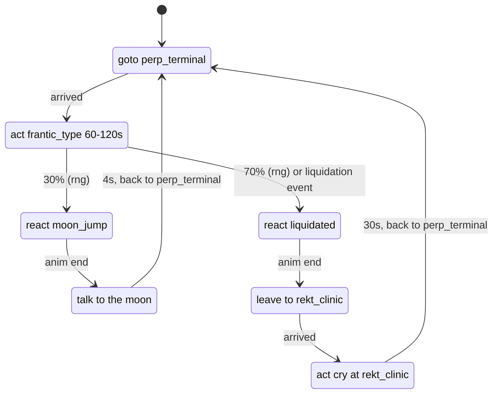
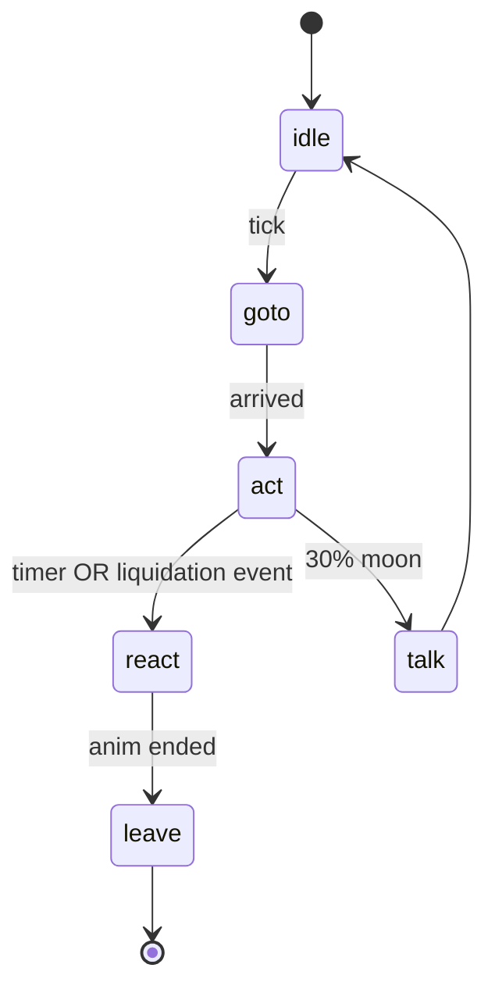

# NPCs

> Every archetype's state machine (diagram), triggers, config keys, and how to add a new one.

The full content lives in M2 onward. M0 ships the directory layout and the pure-library contract. M2 fills in the nine Phase 1 archetypes.

## Perp Degen NPC (Mermaid)



## Package layout

```
packages/npc-brain/
  src/
    state.ts            the eight shared states (idle, wander, goto, act, talk, react, follow, leave)
    archetype.ts        Archetype interface (id, initial state, transitions, lines, cooldowns)
    registry.ts         archetype registry: archetypeId -> Archetype
    rng.ts              seeded Rng; deterministic per-archetype
    clock.ts            Clock interface; tests inject a SimulatedClock
    events.ts           EventSubscriber interface; rooms subscribe to Redis pub/sub
    archetypes/         one file per archetype
      town_crier.ts
      giveaway_guy.ts
      reply_guy.ts
      ...
```

The brain is pure: it has no I/O, no DB, no transport. The composition root (`server/realtime/main.ts`) wires it to a real `Clock`, a real `Rng`, and the Redis event bus.

## Shared states

| State    | Meaning                                      | Exit when                    |
| -------- | -------------------------------------------- | ---------------------------- |
| `idle`   | stand and fidget                             | 5–15 s pass                  |
| `wander` | walk to a random free spot                   | arrives                      |
| `goto`   | walk to a given spot                         | arrives                      |
| `act`    | loop an action anim (type, farm, dance)      | timer ends or an event fires |
| `talk`   | show a line, play babble, gesture            | 3 s                          |
| `react`  | one-shot reaction (liquidated, moon, rugged) | anim ends                    |
| `follow` | stay 2 m behind a target player              | target leaves the venue      |
| `leave`  | walk to the exit and despawn                 | arrives                      |

## Adding a new archetype (worked example)

1. **Register the ID** in `contract/ids/archetypes.json` (and the spec marks it `_provisional` if FE doesn't own it).
2. **Author the lines** in `contract/config/npc_lines.json` — 30 to 60 lines, with `{slots}` filled from `lineParams`.
3. **Create the state machine** in `packages/npc-brain/src/archetypes/<id>.ts`:
   ```ts
   import type { Archetype, ArchetypeCtx } from '../archetype';

   export const my_archetype: Archetype = {
     id: 'my_archetype',
     initial: 'idle',
     transitions: (ctx: ArchetypeCtx) => ({
       // ...
     }),
     lineBank: (ctx) => ctx.config.npc_lines.my_archetype,
   };
   ```
4. **Register** in `packages/npc-brain/src/registry.ts`:
   ```ts
   import { my_archetype } from './archetypes/my_archetype';
   export const registry = new Map<string, Archetype>([
     [my_archetype.id, my_archetype],
     // ...
   ]);
   ```
5. **Add a diagram** to this file (Mermaid stateDiagram) and a one-paragraph description.
6. **Add a test** in `packages/npc-brain/src/__tests__/my_archetype.test.ts` that runs the brain on a simulated clock and asserts the expected transitions and lines.
7. **Run the contract check** to confirm `archetypes.json` is consistent.

## Phase 1 archetypes (M2)

| ID               | Where                                 | Loop                                                                                                                                                                       | Triggers                                                   |
| ---------------- | ------------------------------------- | -------------------------------------------------------------------------------------------------------------------------------------------------------------------------- | ---------------------------------------------------------- |
| `town_crier`     | Timeline Square                       | Patrols 3 spots; on any server event → `talk` with the event's numbers                                                                                                     | every server event                                         |
| `giveaway_guy`   | Timeline Square                       | `goto` square_center, `talk` every 30 s                                                                                                                                    | player taps "drop wallet" → $50 Cash loss, `toast_drained` |
| `reply_guy`      | follows the richest player            | every 20 s `talk` + emote                                                                                                                                                  | target leaves → pick next richest                          |
| `perp_degen_npc` | Perp Pit                              | `goto` terminal → `act` frantic_type 60–120 s → 70% `react` liquidated → `leave` and respawn in Rekt Clinic → `act` cry → `leave`; 30% `react` moon_jump → `talk` → repeat | liquidation event broadcast city-wide                      |
| `rekt_guy`       | Rekt Clinic                           | sits crying, asks for a stimmy                                                                                                                                             | —                                                          |
| `wallet_tracker` | Terminal Café                         | broadcasts the biggest player wins                                                                                                                                         | —                                                          |
| `doomposter`     | Timeline Square, red Market Mood only | calls every -3% a bear market                                                                                                                                              | spawns when Mood < -2%, despawns when positive             |
| `spaces_host`    | Spaces Studio                         | opens an NPC space when no player-hosted space is live                                                                                                                     | no live player space                                       |
| `ore_miner`      | ORE Refinery                          | talks up the board                                                                                                                                                         | ORE motherlode → `talk` with the number                    |

State machine example (Perp Degen NPC):



## Triggers

Triggers come from Redis pub/sub, published by workers. The rooms subscribe via the `EventSubscriber` interface:

| Event topic            | Source          | Where the NPC reacts                                    |
| ---------------------- | --------------- | ------------------------------------------------------- |
| `event.liquidation`    | market worker   | city-wide broadcast + Perp Degen NPC `react liquidated` |
| `event.rug`            | market worker   | Town Crier `talk`, Sleuth "exposé"                      |
| `event.coin_launch`    | market launcher | Town Crier, Rug Dev, Sniper Bots                        |
| `event.mood_change`    | mood worker     | Doomposter spawn/despawn                                |
| `event.exploit`        | market worker   | Sleuth exposé, Audit's `talk`                           |
| `event.ore_motherlode` | ORE reader      | Town Crier, ORE Miner                                   |

## Density

- Max 12 NPCs per venue instance. More are background crowd only.
- NPCs are always marked "NPC" over their heads.

## See also

- `packages/npc-brain` — the library.
- `contract/ids/archetypes.json` and `contract/config/npc_lines.json` (M1).
- `docs/REALTIME.md` — the room where NPCs live.
- `docs/ARCHITECTURE.md` — the event-bus flow.
