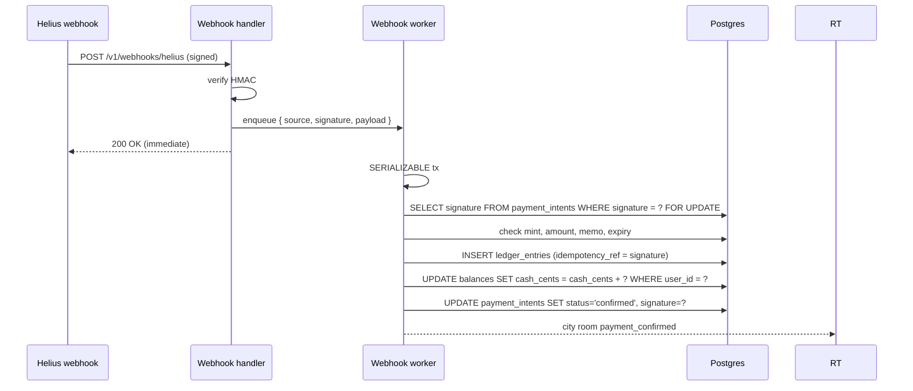

# Onchain

> Every program, PDA, instruction, account, event and error for `ct_escrow`; the payment verification algorithm step by step; the ORE read and stake flows with the ported instruction builders and their source references; devnet and mainnet addresses.

The full content lands in M3 (Anchor tests + IDL commit) and M4 (deployed program + paid-call flow). M0 ships the directory layout and the address audit.

## ct_escrow program

The paid-call escrow on Solana. Adapted from the Anchor escrow example. Anchor 0.31 client, Solana CLI 3.1.10, Rust crate `anchor-lang = "0.31.1"`. **The program has no admin withdraw.** The on-chain Session enforces `1 <= max_minutes <= 60`, and `settle()` / `refund()` must mark the session as `status = 2` or `status = 3` before closing the vault.

### Accounts

**Config PDA** — seeds `["config"]`:

- `admin: Pubkey`
- `settle_authority: Pubkey` — the backend's key (`SETTLE_AUTHORITY_KEYPAIR_*`)
- `treasury: Pubkey` — USDC account owned by the backend
- `usdc_mint: Pubkey`
- `fee_bps: u16` (1000 = 10%)
- `accept_window_secs: u32` (120)
- `bump: u8`

**Session PDA** — seeds `["session", fan, creator, session_id_le_bytes]`:

- `fan, creator: Pubkey`
- `session_id: u64`
- `rate_per_min: u64` (USDC base units)

Known oddities: `Config` includes an extra `vault` field from the original escrow example, and `Session.vault_bump` is unused even though the account layout still carries it. Neither should be removed or reordered for compatibility.

- `max_minutes: u16`
- `deposit: u64` (rate × max × (1 + fee_bps/10000))
- `fee_bps: u16` (copied from Config at `open`)
- `opened_at: i64`
- `accepted_at: i64` (0 until accepted)
- `status: u8` — 0 Open, 1 Accepted, 2 Settled, 3 Refunded
- `bump: u8`

**Vault** — the Session PDA's USDC associated token account.

### Instructions

| Instruction                                           | Signer                  | Effect                                                                                                                                                                                                          |
| ----------------------------------------------------- | ----------------------- | --------------------------------------------------------------------------------------------------------------------------------------------------------------------------------------------------------------- |
| `init_config(fee_bps, accept_window_secs)`            | admin                   | Runs once.                                                                                                                                                                                                      |
| `open_session(session_id, rate_per_min, max_minutes)` | fan                     | Creates the Session and vault. Moves `rate × max × (1 + fee_bps/10000)` from the fan to the vault.                                                                                                              |
| `accept()`                                            | settle_authority        | Sets `accepted_at`. Called after the creator taps Accept.                                                                                                                                                       |
| `settle(seconds_used)`                                | settle_authority        | `minutes = ceil(seconds / 60)` capped at `max`. Pays the creator `rate × minutes` and the treasury that × `fee_bps/10000`, refunds the remainder to the fan, closes the vault and Session with rent to the fan. |
| `refund()`                                            | fan or settle_authority | Refunds everything to the fan if `status = Open` and the accept window has passed, or `status = Accepted` and more than `max × 60 + 600` s have passed since `opened_at`.                                       |

### Events

- `SessionOpened { session_pda, fan, creator, rate_per_min, max_minutes, deposit }`
- `SessionAccepted { session_pda, accepted_at }`
- `SessionSettled { session_pda, minutes, creator_amount, fee, refund }`
- `SessionRefunded { session_pda, refund }`

### Errors

- `InvalidRate` — `rate == 0` or `rate > 50 USDC` per minute. The API enforces `0.25 <= rate <= 50` USDC/min; the program enforces only `0 < rate <= 50`.
- `TooEarlyForRefund` — refund before the accept window or expiry.
- `AlreadyClosed` — double settle or double refund.
- `Unauthorized` — wrong signer.
- `MathOverflow` — overflow in `rate * max * (1 + fee_bps/10000)` or `minutes * rate`.

### Anchor tests (M3 gate)

- Happy path split math (ceil minutes, cap, 10% fee, refund remainder, rent to fan).
- Refund after accept window.
- Refund after `max + 600 s`.
- Unauthorized signers.
- Double settle (`AlreadyClosed`).
- Overflow (`MathOverflow`).
- Invalid rate (`InvalidRate`).
- Fuzz the settle math with `proptest`.

### Paid-call escrow on devnet (unlock C2)

**Status 2026-10-30 (read-only devnet RPC):** program `FKvuRNUxGgijeD8P4varsnzBiLduCWKMhSLQp5fQsMfz`
is deployed (upgrade authority `7EqcBMHrJPDoKCjcwXUJEoY4hewBNtY2aHEgcqXgMwy8`, deployed at slot 507971312) but it is the **old build** from commit `2afe8fc` — the one `contract/idl/ct_escrow.json`
describes, not the current `lib.rs`. Its binary carries the old error strings ("Caller is not the
session creator", "Session is not pending") and none of the current ones. The old build has
creator-signed `accept`, fan-only `refund`, a shared vault, and **no check that `settle` is signed
by the settle authority**. The API's paid-call code targets the current `lib.rs` and refuses an old
Config (`503 CAPABILITY_OFF {reason: escrow_wrong_version}`). The Config PDA does not exist yet (0
program-owned accounts).

Steps (operator, own machine, own keys; nothing in the API holds the admin or upgrade key):

1. **Upgrade the program from the current source** with the upgrade authority above:
   `cd programs/ct_escrow && anchor build -p ct_escrow`, then
   `solana program deploy --url devnet --program-id FKvuRNUxGgijeD8P4varsnzBiLduCWKMhSLQp5fQsMfz --upgrade-authority <upgrade-authority.json> target/deploy/ct_escrow.so`.
   [Unverified] the new `.so` may be larger than the current ProgramData (299,024 bytes); if
   the deploy says so, run `solana program extend <PROGRAM_ID> <extra bytes> --url devnet` first.
   [Unverified] the SOL needed for the upgrade buffer (roughly the rent of the `.so` size,
   refunded when the buffer closes).
2. **Initialize the Config** with `tools/scripts/escrow-init-config.ts` (dry run by default;
   it checks devnet, the build, and that no Config exists):
   `pnpm exec tsx tools/scripts/escrow-init-config.ts --admin <admin.json> --settle-authority <the SETTLE_AUTHORITY_KEYPAIR_DEVNET key file> --treasury <TREASURY_PUBKEY_DEVNET>`,
   check the simulation, then add `--send`. Fee 1000 bps, accept window 120 s.
3. **Fund the settle authority** with ~0.5 devnet SOL: it pays the fees of `accept`, `settle`
   and `refund`, and the rent of a creator's or the treasury's USDC account the first time
   `settle` needs it.
   **Payout accounts (security review M2/M4).** `settle` and `refund` accept any USDC token
   account owned by the fan / creator / treasury (the program checks owner and mint, not the
   ATA address), so no program change is needed. Before each send the server reads the canonical
   ATAs: a usable one is used as is; a missing one is created (idempotent); one handed to another
   owner or frozen is bypassed with a fresh account owned by the same wallet, created in the same
   transaction. Booking requires both players' USDC accounts to exist, so the authority pays
   rent only when someone closed or handed theirs off mid-call, which is capped per user. The
   worker logs `[paid-calls] ALERT` under 0.1 SOL and booking stops under 0.02 SOL.

**Stuck calls.** A refund that keeps failing is parked as `stuck` (ALERT). The worker re-checks
parked calls every 10 minutes and reconciles any whose session closed. After fixing the cause, run
`pnpm exec tsx tools/scripts/paid-calls-requeue.ts --list`, then `--call <id>` or `--all-stuck`
(database only; the worker does the chain work). Live and settling calls are never parked.

**init_config race (review L5).** `init_config` accepts any payer as admin. Run the upgrade
and `tools/scripts/escrow-init-config.ts --send` back to back; if someone else initializes
first, the API refuses the config (`escrow_config_mismatch`) and the program needs another
upgrade.

4. Turn on `paidCalls` and `creatorMode`, and point the LiveKit webhook at
   `https://<api>/v1/webhooks/livekit`.

## Mints and addresses

| Token / account            | Mainnet                                        | Devnet                                         | Notes                              |
| -------------------------- | ---------------------------------------------- | ---------------------------------------------- | ---------------------------------- |
| USDC mint                  | `EPjFWdd5AufqSSqeM2qN1xzybapC8G4wEGGkZwyTDt1v` | `4zMMC9srt5Ri5X14GAgXhaHii3GnPAEERYPJgZJDncDU` | 6 decimals                         |
| SKR mint                   | `SKRbvo6Gf7GondiT3BbTfuRDPqLWei4j2Qy2NPGZhW3`  | unverified                                     | decimals from `economy.json`       |
| ORE mint                   | `oreoU2P8bN6jkk3jbaiVxYnG1dCXcYxwhwyK9jSybcp`  | n/a (mainnet only)                             | 11 decimals                        |
| stORE mint                 | `storenSbvkfzircixnaosc5CbzNZVrHJ6S3EKrS1yqR`  | n/a                                            |                                    |
| ORE program                | `oreV3EG1i9BEgiAJ8b177Z2S2rMarzak4NMv1kULvWv`  | n/a                                            | read-only; we never call `deploy`  |
| ORE stake program          | `stakecNP3FpiExZPCgZfqRgumVzi6dNqnfrjwXyTgeH`  | n/a                                            | seeds `["stake", user]`            |
| Seeker Genesis Token group | `GT22s89nU4iWFkNXj1Bw6uYhJJWDRPpShHt4Bk8f99Te` | n/a                                            | read-only                          |
| ct_escrow program          | (deployed in M4)                               | (deployed in M4)                               | filled in `CT_ESCROW_PROGRAM_ID_*` |

All eight spec addresses were verified by `tools/scripts/verify-onchain.ts` at M0.

## Payment verification algorithm (M3)

Cash top-up, cosmetic, ad booking, and season-pass purchases all use the same flow. The server credits the ledger only when **all** of the following hold:

1. The transaction succeeded at `confirmed`. Reconcile again at `finalized`.
2. It transfers the expected mint to the treasury account, for at least the intent amount.
3. The memo equals the intentId.
4. The reference key is present.
5. The intent has not expired (`expiresAt > now`).
6. The signature was never credited before. Crediting is idempotent on the signature.

A polling reconciler runs every N seconds to pick up webhooks that were missed.

## ORE flows

### Read flow (M3)

The ORE board reader:

- Caches every 2 s.
- Decodes `Board`, `Round`, and `Treasury` accounts from the ORE program.
- Returns `GET /ore/board` with `roundId`, `endsAt`, `endsAtSlot`, `squares[25].deployedLamports`, `motherlodeOre`, `cityStakedOre`, `priceUsd`.
- `GET /ore/me` returns the player's `balance`, `staked`, `stOre`, `minerTier`.
- `minerTier` is derived from the player's ORE balance and the `["stake", user]` PDA. Tiers: `prospector` (any ORE), `miner` (≥ 1 ORE staked), `refiner` (≥ 10 ORE staked).

### Stake flow (M3)

`POST /ore/stake/tx` returns an unsigned v0 transaction for MWA. The action is one of `deposit | withdraw | claim | compound`. The amount is optional and required for deposit/withdraw.

The instruction builders are ported from the Rust `ore-stake-api = "0.3.0"` crate to TypeScript with `@solana/kit`. The porting procedure is:

1. Download the crate source.
2. Derive the discriminators (first 8 bytes of `sha256("global:<name>")`).
3. Derive the account metas per the IDL.
4. Build the instruction with `TransactionInstruction` from `@solana/kit`.
5. Verify the produced instruction bytes by simulating the transaction on mainnet (`simulateTransaction`, no send) against the live stake program.

The ORE-stake TypeScript port lives in `server/shared/solana/ore-stake/` (M3). It has a contract test that round-trips a known instruction against a Rust-built reference.

### Town Crier and ORE NPC

`Town Crier` shouts real motherlode hits on the city room: `"JUST IN: motherlode hit, 55 ORE"`. The ORE reader worker publishes the `event.ore_motherlode` event to Redis pub/sub.

## ORE payments

- ORE top-ups use `TransferChecked` with 11 decimals.
- They go through the same intent checks as USDC, with the ORE mint.
- `bonusBps = 1500` (+15% Cash) is applied at intent creation.

## See also

- `programs/ct_escrow/` — Anchor source (M3+).
- `docs/ECONOMY.md` — the numbers.
- `docs/DECISIONS.md` — version pinning and `ore-stake-api` source reference.
