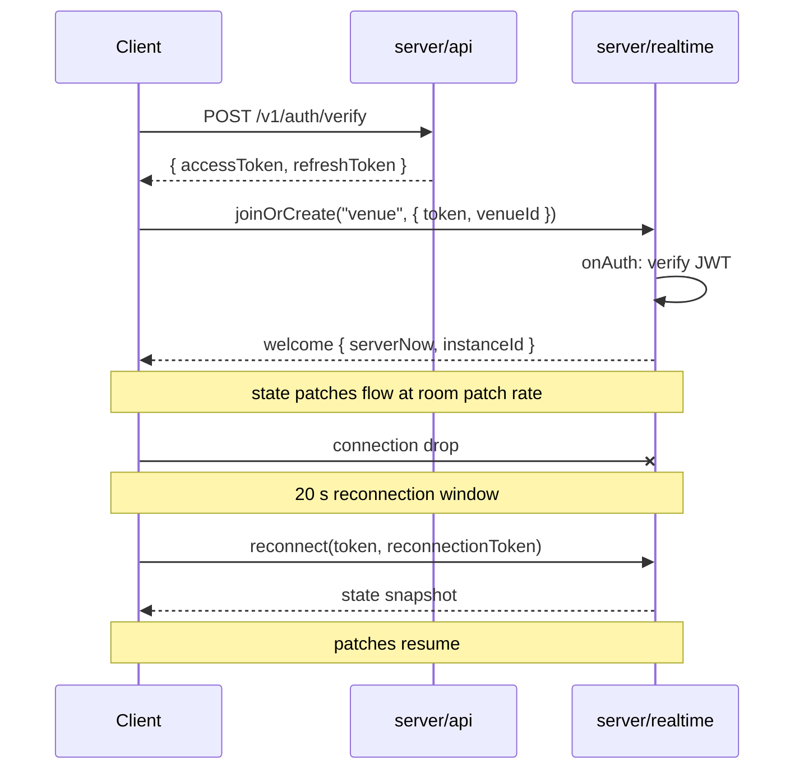

# Realtime

> Every room, every state field, every message (direction, payload, validation, limits, error codes), the join and reconnection flow, and sequence diagrams.

The full content lives in M1 onward. M0 ships the directory layout and the message-validation pattern; M1 fills in the schemas and message types per the contract.

## Rooms

| Ph  | Room     | One per                           | Max clients | Patch rate | State                                    |
| --- | -------- | --------------------------------- | ----------- | ---------- | ---------------------------------------- |
| 1   | `city`   | Whole game, sharded at 1,000      | 1,000       | 1 Hz       | online count, Market Mood, active events |
| 1   | `venue`  | Venue instance (filterBy venueId) | 50          | 10 Hz      | players and NPCs in that venue           |
| 2   | `market` | Whole game, sharded (M3)          | 2,000       | 0.5 Hz     | live coins                               |
| 4   | `home`   | Player home, created on visit     | 12          | 10 Hz      | same schema as venue                     |

## State (will be filled in M1)

The M1 milestone produces `contract/realtime/*.ts` with `@colyseus/schema` classes:

- `VenueState` — `players` (map of `PlayerState` by sessionId), `npcs` (map of `NpcState` by npcId).
- `MarketState` — `coins` (map of `CoinState` by coinId).
- `CityState` — `online`, `mood`, `eventIds`, `metaId`.
- `HomeState` — same as VenueState.

`PlayerState` (M1):

- `userId, name, skrName, tribeId: string` — `name` is the alias, `skrName` is empty if the player has none.
- `isSeeker: boolean` — Seeker badge.
- `minerTier: string` — `none | prospector | miner | refiner`.
- `look: string[7]` — `[skinTone, headId, hairId, topId, bottomId, shoesId, accId]`.
- `x, z, rotY: float32` — metres and radians, venue-local.
- `anim: string` — server-set; client never sends.
- `emoteId, emoteAt: string, number` — epoch ms in server time.
- `spotId: string` — set while seated or at a terminal.
- `talking: boolean` — mirrors LiveKit speaking state.

`NpcState` (M1):

- `archetypeId: string` — from `archetypes.json`.
- `state: string` — from `npc_states.json`.
- `spotId: string` — target spot for `goto` / `wander` / `act`.
- `animId: string` — clip for `act` and `react`.
- `targetUserId: string` — for `follow`.
- `lineId, lineParams: string, map<string, string>` — example `crier_coin_moon` with `{coin: "FROGE", x: "3.2"}`.
- `emoteId: string`.
- `startedAt: number` — epoch ms in server time.

`CoinState` (M3):

- `coinId, ticker, name: string`.
- `stage: string` — `new | final | graduated | dead`.
- `priceMicros, mcapCents: int64`, `vol5mCents, change5mBps, holders, launchedAt: int` / number.
- **Hidden:** the `hiddenArc` (stealth / hype / peak / outcome) lives only on the server and is never sent.

## Messages (will be filled in M1)

The M1 milestone produces the `messages.ts` types with Zod validation:

### Client → server

| Room    | Type      | Payload          | Limit / validation                                                                         |
| ------- | --------- | ---------------- | ------------------------------------------------------------------------------------------ |
| `venue` | `move`    | `{ x, z, rotY }` | 10/s; server rejects speeds > 6 m/s and points outside walkable rectangles in `spots.json` |
| `venue` | `sit`     | `{ spotId }`     | spot exists and free, else `SPOT_TAKEN`                                                    |
| `venue` | `stand`   | `{}`             | —                                                                                          |
| `venue` | `emote`   | `{ emoteId }`    | once per second; id must be in `anims.json`                                                |
| `venue` | `say`     | `{ text }`       | 140 chars, once per 2 s; strip links and phone numbers; profanity filter                   |
| `venue` | `talking` | `{ on }`         | mirrors LiveKit                                                                            |
| `venue` | `npc_tap` | `{ npcId }`      | Phase 1: tapping Giveaway Guy's "drop wallet" costs $50 Cash, sends `toast_drained`        |

### Server → client

| Room     | Type                | To                                | Payload                                                                                  |
| -------- | ------------------- | --------------------------------- | ---------------------------------------------------------------------------------------- |
| any      | `welcome`           | joiner                            | `{ serverNow, instanceId }`                                                              |
| `venue`  | `said`              | everyone (except blocked senders) | `{ messageId, userId, sessionId, text, at }`                                             |
| `venue`  | `toast`             | one player                        | `{ textId, params }`                                                                     |
| `venue`  | `rejected`          | one player                        | `{ type, code }` (e.g. `SPOT_TAKEN`, `RATE_LIMITED`)                                     |
| `city`   | `event`             | everyone                          | `{ eventId, params, at }` — liquidations, rugs, launches, exploits, mood, ORE motherlode |
| `city`   | `liquidated`        | one player                        | `{ perpId, coinId, lossCents, at }` (REKT card)                                          |
| `city`   | `payment_confirmed` | one player                        | `{ intentId, cashCents }`                                                                |
| `city`   | `space_update`      | everyone in that space            | `{ spaceId }`                                                                            |
| `city`   | `dm`                | one player                        | `{ messageId, fromUserId, text, at }`                                                    |
| `city`   | `call_invite`       | one player                        | `{ callId, fromUserId, paid }`                                                           |
| `city`   | `kicked`            | one player                        | `{ reasonId }`                                                                           |
| `market` | `tape`              | everyone                          | `{ coinId, side, cashCents, name }` (trades >= $1,000 only)                              |

## Join and reconnection

## Sharding and overflow

- `city` is sharded at 1,000 clients. A full shard forces a new instance.
- `venue` is sharded at 50. A full venue overflows into a parallel instance of the same venue; the new instance is announced on the city room.
- `market` is sharded in M3; market rooms are read-only subscribers to the leader via Redis pub/sub. The contract change is additive (multiple `market` rooms instead of one) and is recorded in `contract/CHANGELOG.md`.
- `home` is one room per visit, max 12 clients.

## Rate limits

| Action                             | Limit         | Returned on exceed                |
| ---------------------------------- | ------------- | --------------------------------- |
| REST, per user                     | 20 req/s      | `RATE_LIMITED`                    |
| `move`                             | 10/s          | `RATE_LIMITED` (rejected message) |
| `say`                              | 1 per 2 s     | `RATE_LIMITED`                    |
| `emote`                            | 1/s           | `RATE_LIMITED`                    |
| Login, per IP                      | 5 in 60 s     | `RATE_LIMITED`                    |
| Account/character creation, per IP | 3 in 60 s     | `RATE_LIMITED`                    |
| Global login concurrency           | 200 in flight | `SERVER_BUSY` with `Retry-After`  |

## Chat filter

- Strip links and phone numbers from `say`.
- Profanity filter is applied server-side. Filtered words are replaced with `***`; the client never sees the raw word.
- Blocked senders' messages are not sent to the blocked user (per-block per-room). DMs from a blocked user are dropped at the API layer.
- A `report` action is always available; reports surface in the moderation queue.

## See also

- `contract/realtime/*.ts` — the generated schemas and message types (M1).
- `docs/SECURITY.md` — rate-limit and authz matrix.
- `docs/ARCHITECTURE.md` — process boundaries.
