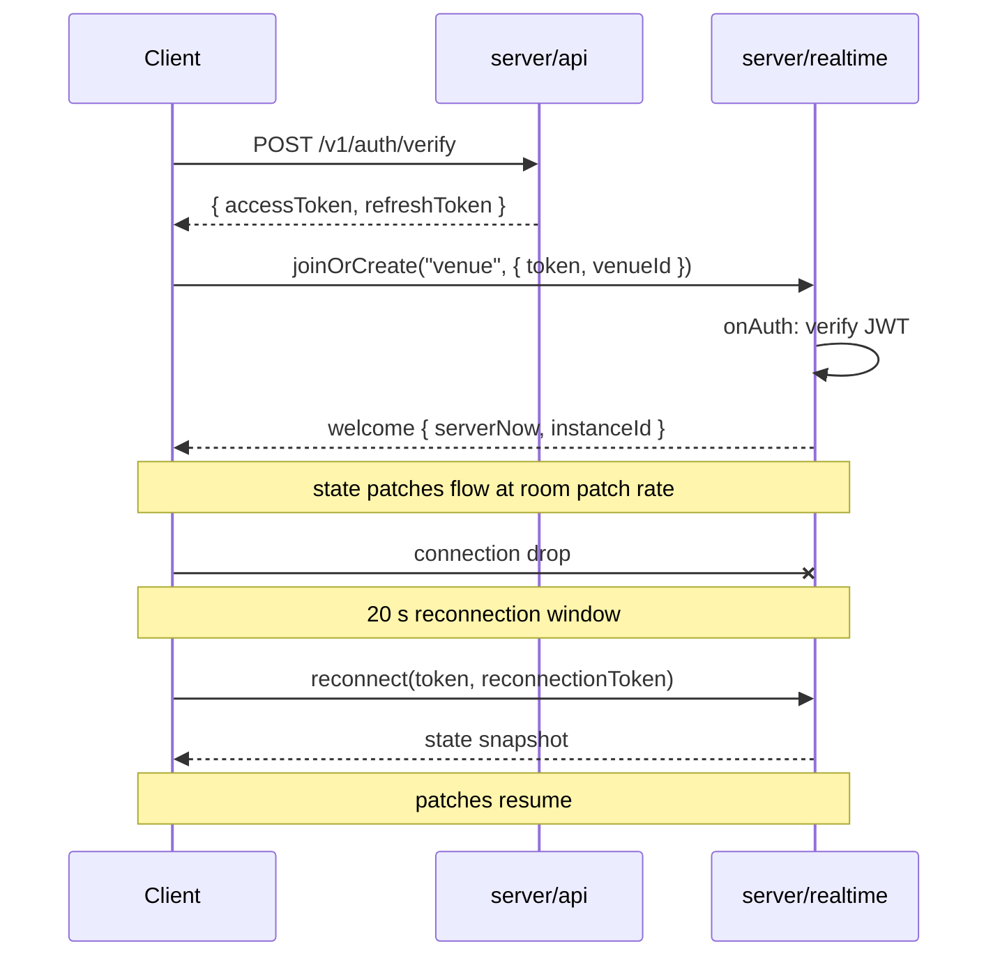

# Realtime

> Every room, every state field, every message (direction, payload, validation, limits, error codes), the join and reconnection flow, and sequence diagrams.

The full content lives in M1 onward. M0 ships the directory layout and the message-validation pattern; M1 fills in the schemas and message types per the contract.

## Rooms

| Ph  | Room       | One per                           | Max clients | Patch rate | State                                              |
| --- | ---------- | --------------------------------- | ----------- | ---------- | -------------------------------------------------- |
| 1   | `city`     | Whole game, sharded at 1,000      | 1,000       | 1 Hz       | online count, Market Mood, active events           |
| 1   | `venue`    | Venue instance (filterBy venueId) | 50          | 10 Hz      | players and NPCs in that venue                     |
| 2   | `market`   | Whole game, sharded (M3)          | 2,000       | 0.5 Hz     | live coins                                         |
| 4   | `home`     | Player home, created on visit     | 12          | 10 Hz      | same schema as venue                               |
| 7   | `street`   | District (filterBy district)      | 100         | 10 Hz      | players walking that district, island metres       |
| 7   | `vehicles` | Whole island, one room            | 1,000       | 10 Hz      | vehicles; each client sees only those within 250 m |

## State (will be filled in M1)

The M1 milestone produces `contract/realtime/*.ts` with `@colyseus/schema` classes:

- `VenueState` — `players` (map of `PlayerState` by sessionId), `npcs` (map of `NpcState` by npcId).
- `MarketState` — `coins` (map of `CoinState` by coinId).
- `CityState` — `online`, `mood`, `eventIds`, `metaId`.
- `HomeState` — same as VenueState.
- `StreetState` - `district`, `instanceId`, `players` (map of `PlayerState` by sessionId). x/z are island metres (+X east, +Z north, origin at the downtown plaza).
- `VehiclesState` - `vehicles` (map of `VehicleState` by id, filtered per client with `@view()`: within 250 m in, past 300 m out, refreshed at 1 Hz; your own vehicle always).

`VehicleState`:

- `id, kind, driver: string` - `kind` is `compact | suv | sports | moped | roadstar | heli | drone | sedan | taxi | police | pickup | van | bike`; `driver` is the driver's userId or `''` when parked.
- `x, y, z, yaw, pitch, roll, speed: float32` - island metres, radians, m/s.
- `flags: uint16` - client-defined bits.

`PlayerState` (M1):

- `userId, name, skrName, tribeId: string` — `name` is the alias, `skrName` is empty if the player has none.
- `isSeeker: boolean` — Seeker badge.
- `minerTier: string` — `none | prospector | miner | refiner`.
- `look: string[7]` — `[skinTone, headId, hairId, topId, bottomId, shoesId, accId]`.
- `x, z, rotY: float32` — metres and radians, venue-local.
- `anim: string` — server-set; client never sends.
- `emoteId, emoteAt: string, number` — epoch ms in server time.
- `spotId: string` — set while seated or at a terminal.
- `talking: boolean` — mirrors LiveKit speaking state.
- `ix, iz, irotY: float32` - island pose, server-filled. Same as x/z/rotY in street rooms; the converted position in venue rooms placed on CT Island; 0 in venues that are not placed.

`NpcState` (M1):

- `archetypeId: string` — from `archetypes.json`.
- `state: string` — from `npc_states.json`.
- `spotId: string` — target spot for `goto` / `wander` / `act`.
- `animId: string` — clip for `act` and `react`.
- `targetUserId: string` — for `follow`.
- `lineId, lineParams: string, map<string, string>` — example `crier_coin_moon` with `{coin: "FROGE", x: "3.2"}`.
- `emoteId: string`.
- `startedAt: number` — epoch ms in server time.

`CoinState` (M3):

- `coinId, ticker, name: string`.
- `stage: string` — `new | final | graduated | dead`.
- `priceMicros, mcapCents: int64`, `vol5mCents, change5mBps, holders, launchedAt: int` / number.
- **Hidden:** the `hiddenArc` (stealth / hype / peak / outcome) lives only on the server and is never sent.

## Messages (will be filled in M1)

The M1 milestone produces the `messages.ts` types with Zod validation:

### Client → server

| Room              | Type                      | Payload                                            | Limit / validation                                                                                                                                                                                                                                                                                                                                                                                                                                                                                                           |
| ----------------- | ------------------------- | -------------------------------------------------- | ---------------------------------------------------------------------------------------------------------------------------------------------------------------------------------------------------------------------------------------------------------------------------------------------------------------------------------------------------------------------------------------------------------------------------------------------------------------------------------------------------------------------------- |
| `venue`, `street` | `move`                    | `{ x, z, rotY, island? }`                          | 10/s sustained, bursts of 5. Distance budget from the last accepted move: refills at 6.5 m/s, 0.5 m slack, at most 1 s banked. Past the budget the move is clamped, applied and answered with `corrected`. Venue rooms: `island: true` means x/z/rotY are island coordinates; the server converts them and answers in the same frame. Venue: target must be inside a walkable rectangle in `spots.json`. Street: inside the island outline and within 30 m of the district polygon in `districts.json`, else `OUT_OF_BOUNDS` |
| `venue`           | `sit`                     | `{ spotId }`                                       | spot exists and free, else `SPOT_TAKEN`                                                                                                                                                                                                                                                                                                                                                                                                                                                                                      |
| `venue`           | `stand`                   | `{}`                                               | -                                                                                                                                                                                                                                                                                                                                                                                                                                                                                                                            |
| `venue`           | `emote`                   | `{ emoteId }`                                      | once per second; id must be in `anims.json`                                                                                                                                                                                                                                                                                                                                                                                                                                                                                  |
| `venue`           | `say`                     | `{ text }`                                         | 140 chars, once per 2 s; strip links and phone numbers; profanity filter                                                                                                                                                                                                                                                                                                                                                                                                                                                     |
| `venue`           | `talking`                 | `{ on }`                                           | mirrors LiveKit                                                                                                                                                                                                                                                                                                                                                                                                                                                                                                              |
| `venue`           | `npc_tap`                 | `{ npcId }`                                        | Phase 1: tapping Giveaway Guy's "drop wallet" costs $50 Cash, sends `toast_drained`                                                                                                                                                                                                                                                                                                                                                                                                                                          |
| `street`          | `emote`, `say`, `talking` | as venue                                           | as venue                                                                                                                                                                                                                                                                                                                                                                                                                                                                                                                     |
| `vehicles`        | `vehicle_enter`           | `{ id, kind?, x?, y?, z?, yaw? }`                  | Vehicle free (`VEHICLE_TAKEN`), within 4 m of the player's street position (`VEHICLE_TOO_FAR`; `POSITION_UNKNOWN` if none in the last 5 s), not already driving (`ALREADY_DRIVING`). A `roadstar` (the hovercar) needs the player's `vehicle.hovercar` entitlement (`NOT_ENTITLED`). Unknown `id` with `kind` + pose registers a client-parked car there (2 per player, 400 total, `VEHICLE_LIMIT`; removed after 10 min unused). 2/s                                                                                        |
| `vehicles`        | `vehicle_move`            | `{ id, x, y, z, yaw, pitch, roll, speed, flags? }` | Driver only (`NOT_DRIVER`), 10 Hz. Distance budget at the kind's cap (cars 60, moped and bike 25, roadstar 70, heli 60, drone 20 m/s; 1 s banked), `speed` capped, y in -20..214. Clamped moves get `vehicle_corrected`. More than 50 m outside the island outline is `OUT_OF_BOUNDS`                                                                                                                                                                                                                                        |
| `vehicles`        | `vehicle_exit`            | `{ id, x, z, yaw }`                                | Driver only. Final parked pose (x/z ignored if more than 6 m from the last move). The street rooms accept the player's next move within 5 m of it without the walking rule (15 s). Disconnecting while driving parks the vehicle the same way                                                                                                                                                                                                                                                                                |
| `vehicles`        | `vehicle_hit`             | `{ victim, velocity: {x,y,z} }`                    | Sender must be driving at >= 3 m/s; impact <= min(kind cap, vehicle speed + 5); victim within 8 m of the vehicle (plus drift for their position's age). One hit per victim per 1.5 s; 2/s per sender. Relayed to the victim only                                                                                                                                                                                                                                                                                             |

### Server → client

| Room              | Type                | To                                | Payload                                                                                                                                                                                                                                                                   |
| ----------------- | ------------------- | --------------------------------- | ------------------------------------------------------------------------------------------------------------------------------------------------------------------------------------------------------------------------------------------------------------------------- |
| any               | `welcome`           | joiner                            | `{ serverNow, instanceId, island? }`; venue rooms on CT Island add `island {x, y, z, yaw}`                                                                                                                                                                                |
| `venue`           | `said`              | everyone (except blocked senders) | `{ messageId, userId, sessionId, text, at }`                                                                                                                                                                                                                              |
| `venue`           | `toast`             | one player                        | `{ textId, params }`                                                                                                                                                                                                                                                      |
| `venue`           | `rejected`          | one player                        | `{ type, code }` (e.g. `SPOT_TAKEN`, `RATE_LIMITED`); a rejected `move` adds the server `x, z` when known                                                                                                                                                                 |
| `venue`, `street` | `corrected`         | one player                        | `{ x, z, island? }`: the server clamped your move to this position (island frame if you sent `island: true`); snap to it                                                                                                                                                  |
| `vehicles`        | `vehicle_corrected` | the driver                        | `{ id, x, y, z }`: same, for the vehicle                                                                                                                                                                                                                                  |
| `vehicles`        | `vehicle_hit`       | the victim                        | `{ victim, velocity, by, vehicleId, at }`: ragdoll locally (schema `vehicle_hit_relay`, sent as `vehicle_hit`)                                                                                                                                                            |
| `city`            | `event`             | everyone                          | `{ eventId, params, at }` - liquidations, rugs, launches, exploits, mood, ORE motherlode                                                                                                                                                                                  |
| `city`            | `liquidated`        | one player                        | `{ perpId, coinId, lossCents, at }` (REKT card)                                                                                                                                                                                                                           |
| `city`            | `payment_confirmed` | one player                        | `{ intentId, cashCents }`                                                                                                                                                                                                                                                 |
| `city`            | `space_update`      | everyone in that space            | `{ spaceId }`                                                                                                                                                                                                                                                             |
| `city`            | `dm`                | one player                        | `{ messageId, fromUserId, text, at }`                                                                                                                                                                                                                                     |
| `city`            | `delivery_out`      | one player                        | `{ orderId, destination, unitId, etaAt }`: a Duo Shop courier leaves about 60 s before `etaAt` (epoch ms); `unitId` is the door, null for the lobby locker. Spawn the van                                                                                                 |
| `city`            | `delivery_arrived`  | one player                        | `{ orderId, destination, unitId }`: the order is delivered and its items are in `GET /me/items`. Drop the parcel at the door or fill the locker                                                                                                                           |
| `city`            | `event_live`        | everyone                          | `{ slug, title, kind, city, skinId, ingameVenueId, streamUrl, endsAt, at }`: a real event (Breakpoint) just started; `endsAt` and `at` are epoch ms. Switch the venue to `skinId`, show the countdown and the stream link-out. Late joiners read `GET /v1/events/current` |
| `city`            | `event_ended`       | everyone                          | `{ slug, title, kind, skinId, endedAt, at }`: the event window closed (epoch ms). Drop the skin and the event quests. Sent by a per-minute worker sweep, so up to about a minute late                                                                                     |
| `city`            | `call_invite`       | one player                        | `{ callId, fromUserId, paid }`                                                                                                                                                                                                                                            |
| `city`            | `kicked`            | one player                        | `{ reasonId }`                                                                                                                                                                                                                                                            |
| `market`          | `tape`              | everyone                          | `{ coinId, side, cashCents, name }` (trades >= $1,000 only)                                                                                                                                                                                                               |

## Join and reconnection

## Sharding and overflow

- `city` is sharded at 1,000 clients. A full shard forces a new instance.
- `venue` is sharded at 50. A full venue overflows into a parallel instance of the same venue; the new instance is announced on the city room.
- `market` is sharded in M3; market rooms are read-only subscribers to the leader via Redis pub/sub. The contract change is additive (multiple `market` rooms instead of one) and is recorded in `contract/CHANGELOG.md`.
- `home` is one room per visit, max 12 clients. A home with a door (`home_units`) admits only its owner and guests; anyone else is refused on join with `FORBIDDEN`. A home without a door is open. Join with the `homeId` that `POST /homes/{ownerId}/visit` returns.
- `street` is one room per district, overflowing at 100. Bounds come from `contract/ids/districts.json`, generated from the frontend island plan by `tools/scripts/import-districts.ts` (`pnpm tsx tools/scripts/import-districts.ts <plan.json> [label]`). District ids: `timeline`, `trenches`, `dubai_marina`, `boardwalk`, `airdrop_farm`, `builder_hills`, `breakpoint`, `residences`, `mountain`, `islet`.
- `vehicles` is a single island-wide room; interest management keeps each client's patches to nearby vehicles. Server-owned parked vehicles come from `contract/ids/parking.json` (one per bay, id = bay id); an abandoned bay car returns to its bay after 10 min once nobody is within 150 m.
- A player may be in two venue/street rooms at once (the client joins the next room about 1 s before leaving the last). Rooms do not de-duplicate users.

## Rate limits

| Action                             | Limit         | Returned on exceed               |
| ---------------------------------- | ------------- | -------------------------------- |
| REST, per user                     | 20 req/s      | `RATE_LIMITED`                   |
| `move`                             | 10/s, burst 5 | dropped silently                 |
| `vehicle_move`                     | 12/s, burst 6 | dropped silently                 |
| `vehicle_enter`, `vehicle_hit`     | 2/s, burst 3  | `RATE_LIMITED` / dropped         |
| `say`                              | 1 per 2 s     | `RATE_LIMITED`                   |
| `emote`                            | 1/s           | `RATE_LIMITED`                   |
| Login, per IP                      | 5 in 60 s     | `RATE_LIMITED`                   |
| Account/character creation, per IP | 3 in 60 s     | `RATE_LIMITED`                   |
| Global login concurrency           | 200 in flight | `SERVER_BUSY` with `Retry-After` |

## Chat filter

- Strip links and phone numbers from `say`.
- Profanity filter is applied server-side. Filtered words are replaced with `***`; the client never sees the raw word.
- Blocked senders' messages are not sent to the blocked user (per-block per-room). DMs from a blocked user are dropped at the API layer.
- A `report` action is always available; reports surface in the moderation queue.

## See also

- `contract/realtime/*.ts` — the generated schemas and message types (M1).
- `docs/SECURITY.md` — rate-limit and authz matrix.
- `docs/ARCHITECTURE.md` — process boundaries.
