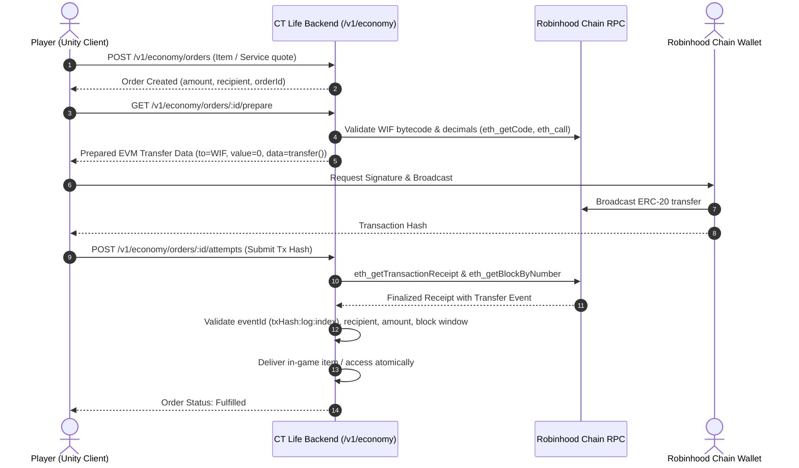

# WorldIsFlat Hackathon: CT Life × WIF on Robinhood Chain

**Event:** WorldIsFlat (WIF Hackathon)  
**Submission Deadline:** November 12, 2026, 17:30 UTC (18:30 Lagos)  
**Judging Period:** November 12 – November 16, 2026  
**Track:** Gaming, Utility & Real-World Micropayments on Robinhood Chain  
**Team Members:** deviykee (Iyke) & Trimmy (Joel / Dominion) — 2 members (Max 4, Age 18+)  
**Repository Access:** GitHub invite granted to `wifonrh`  

---

## 1. Project Overview

**CT Life** is an open-world 3D multiplayer life simulator built for crypto-native social gameplay. Players explore an active city, customize apartments, interact with NPCs and other live players, voice-chat in proximity, take jobs, and participate in an on-chain player-driven economy.

Through our Robinhood Chain integration, **$WIF** is not just a speculative token, but a primary utility currency embedded throughout city commerce, services, and luxury progression.

---

## 2. Genuine Repeat-Use $WIF Utility in CT Life

CT Life integrates genuine, repeat-use WIF utility on Robinhood Chain:

1. **DuoShop Instant In-Game Deliveries:**
   * Players can order food, consumables, and utility items directly to their location via the in-game phone.
   * Orders are quoted dynamically, settled natively in WIF on Robinhood Chain, and couriers deliver the order to the player's coordinate.
2. **VIP Venue Access & Cover Charges:**
   * High-roller clubs, the Penthouse, and luxury marina venues enforce on-chain door entry.
   * Players pay entrance fees in WIF directly on Robinhood Chain, triggering server-side gate clearance.
3. **Exclusive High-Status Wearables & Cosmetics:**
   * In-game streetwear, custom avatar outfits, and rare badges can be purchased with WIF.
   * Payments are processed via atomic quote settlement: immutable orders, finalized block verification, and instant inventory attribution.
4. **Casino Chips & High-Stakes Tables:**
   * WIF is accepted for chip purchases at the Rug Room casino with provably fair server-side outcomes and RTP audit.

---

## 3. Robinhood Chain Specification

* **Network Name:** Robinhood Chain
* **Chain ID:** `4663` (Hex: `0x1237`)
* **RPC Endpoint:** `https://rpc.mainnet.chain.robinhood.com`
* **Block Explorer:** [`https://robinhoodchain.blockscout.com`](https://robinhoodchain.blockscout.com)
* **Official WIF Token Address:** `0x5173b8ea6923c2d40267890d45c46a3480954773`
* **Token Standard:** ERC-20 (18 Decimals)

---

## 4. Architecture & Technical Implementation

Payment handling is implemented with bank-grade safety, replay protection, and verifiable event confirmation:



### Key Safety Guarantees:
- **No Unchecked Hashes:** Submitting a transaction hash never grants goods; the backend verifies receipt status (`status === 0x1`), canonical finalized block height, and event topic log index.
- **Replay Protection:** Unique event ID `(${txHash}:log:${logIndex})` is claimed atomically in PostgreSQL. Duplicate attempts on the same receipt are strictly refused.
- **Late Payment & Duplicate Handling:** Extra or late transfers are automatically recorded under `economy_receipts` as `refund_due`, protecting player funds.

---

## 5. Live Reproducible Verification

Judges can execute the live Robinhood Chain verification test directly from the repository:

```bash
# Clone and install dependencies
git clone git@github.com:devIykee/ct-life-backend.git
cd ct-life-backend
pnpm install

# Run the live Robinhood Chain WIF integration verification
pnpm tsx tools/scripts/test-robinhood-wif-payment.ts
```

**Expected Output:**
```
======================================================
🪙 CT Life - Robinhood Chain WIF Integration Test
======================================================

Connecting to Robinhood Chain RPC: https://rpc.mainnet.chain.robinhood.com
1. Checking eth_chainId...
   -> Chain ID: 0x1237 (4663)
   ✅ Robinhood Chain confirmed (4663).

2. Verifying WIF contract at 0x5173b8ea6923c2d40267890d45c46a3480954773...
   -> Contract code length: 6498 chars (deployed bytecode verified)
   -> WIF decimals: 18
   ✅ WIF contract bytecode & 18 decimals verified on Robinhood Chain.

3. Querying latest finalized block on Robinhood Chain...
   -> Finalized Block: #111592968
   -> Block Hash:      0x245574adf797befcff878fc4feb2c7b829855c442c8779ad3196501bb0376083
   -> Block Timestamp: 2026-11-11T09:19:22.000Z
   ✅ Finalized state stream operational.

4. Testing preparePayment for an in-game WIF purchase...
   Prepared Payment: {
     "kind": "evm",
     "chainId": "eip155:4663",
     "transaction": {
       "from": "0x1111111111111111111111111111111111111111",
       "to": "0x5173b8ea6923c2d40267890d45c46a3480954773",
       "data": "0xa9059cbb...",
       "value": "0x0",
       "chainId": "0x1237"
     }
   }
   ✅ preparePayment produced valid ERC20 transfer payload for Robinhood Chain.
```

---

## 6. Video Walkthrough & Judge Access

- **Live Game Demo:** Available at `https://play.ctlife.fun`
- **Private Repository Invite:** Sent to `wifonrh` on GitHub.
- **Support & Questions:** Available via Telegram (@Trimmy / @deviykee).
